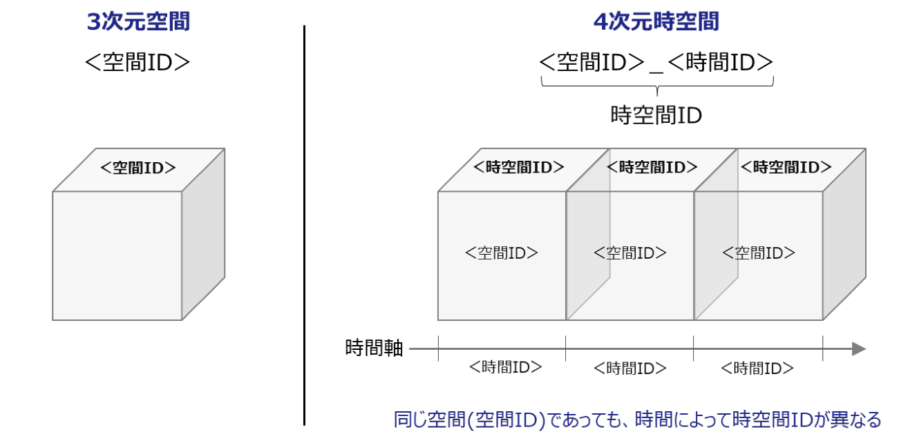
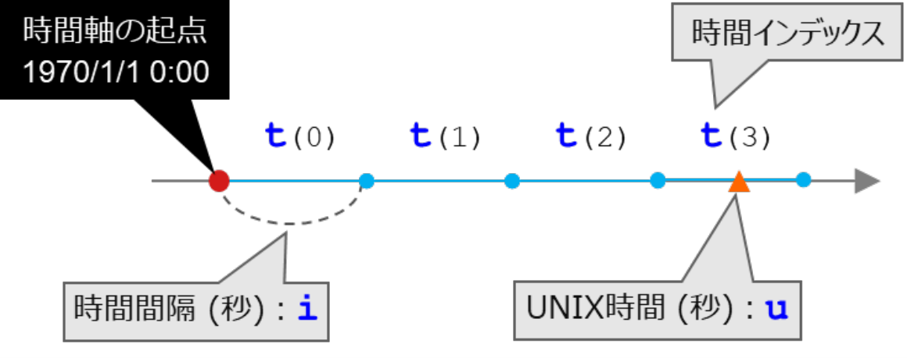

import MadoriFrame from '../../../components/MadoriFrame.astro';
import TablerIcon from '../../../components/TablerIcon.astro';
import timeJson from '../../../assets/madori/time-animation.json?raw';
import voxelFigure from '../../../assets/ipa/ipa-fig2-3-voxel.png';
import horizontalIndexFigure from '../../../assets/ipa/ipa-fig2-6-horizontal-index.png';

## 空間ID とは

空間ID は、地球上の空間を格子状に区切ったボクセルのインデックスです。IPAの[空間ID ガイドライン](https://www.ipa.go.jp/digital/architecture/Individual-link/rcu1hd000000upgf-att/4dspatio-temporal-id-guideline-v1_2.pdf)で定義されています。書式は `z/f/x/y` で、例えば `2/0/3/1` のように書きます。

<div class="side-by-side">
<div>

| 記号 | 意味 |
| --- | --- |
| `z` | ズームレベル |
| `f` | 高さ方向のインデックス |
| `x` | 東西方向のインデックス |
| `y` | 南北方向のインデックス |

</div>
<div class="side-figure-column">


<p class="figure-caption">図 2-3 空間ID のイメージ（出典：[空間 ID ガイドライン 1.2 版](https://www.ipa.go.jp/digital/architecture/Individual-link/rcu1hd000000upgf-att/4dspatio-temporal-id-guideline-v1_2.pdf)）</p>

</div>
<div class="side-figure-column">


<p class="figure-caption">図 2-6 水平方向の分割とインデックスの割り当て（出典：[空間 ID ガイドライン 1.2 版](https://www.ipa.go.jp/digital/architecture/Individual-link/rcu1hd000000upgf-att/4dspatio-temporal-id-guideline-v1_2.pdf)）</p>

</div>
</div>

## ズームレベルと親子関係

ズームレベルが 1 上がると、ボクセルは各辺が半分になり 8 分割されます。`f`・`x`・`y` を 2 で割って切り捨てると、1 つ粗いズームレベルの親になります。例えば、`3/0/7/2` の親は `2/0/3/1` となり、`20/0/931389/412900` の親は `19/0/465694/206450` です。

<div class="figure-pair">
<div>

<MadoriFrame ids={['20/0/931389/412900', '19/0/465694/206450']} view camera={{ bearing: 0, pitch: 0 }} />

<p class="figure-caption">20/0/931389/412900（緑）と親の 19/0/465694/206450（ピンク）</p>

</div>
<div>

<MadoriFrame ids={['20/0/931393/412896', '19/0/465697/206448', '18/0/232849/103224', '17/0/116425/51612', '16/0/58213/25806']} view camera={{ longitude: 139.7766, latitude: 35.6842, zoom: 13.35, bearing: 45, pitch: 55 }} />

<p class="figure-caption">ズームレベル 20〜16 のボクセル</p>

</div>
</div>

インデックスの範囲は、`f` が −2<sup>z</sup> 〜 2<sup>z</sup> − 1、`x`・`y` が 0 〜 2<sup>z</sup> − 1 です。


## 時空間IDとは

時空間ID は、空間ID に時間インデックスを付けたものです。同じ空間ID でも、時間インデックスが違えば別の時空間ID になります。


<p class="figure-caption">図 2-21 空間 ID と時空間 ID の比較イメージ（出典：[空間 ID ガイドライン 1.2 版](https://www.ipa.go.jp/digital/architecture/Individual-link/rcu1hd000000upgf-att/4dspatio-temporal-id-guideline-v1_2.pdf)）</p>

時間軸を UNIX エポックから時間間隔 `i`（秒）ごとに区切り、UNIX 時間 `u` が入る区間の番号を `t = floor(u / i)` とします。書式は `{z}/{f}/{x}/{y}_{i}/{t}` で、例えば `16/0/58210/25800_1/0` のように書きます。



<p class="figure-caption">図 2-23 分割された時間軸における各要素（出典：[空間 ID ガイドライン 1.2 版](https://www.ipa.go.jp/digital/architecture/Individual-link/rcu1hd000000upgf-att/4dspatio-temporal-id-guideline-v1_2.pdf)）</p>

```ts
const t = Math.floor(Date.UTC(1970, 0, 1, 0, 0, 0) / 1000 / 1); // 0
// 16/0/58210/25800_1/0 は、1970-01-01 00:00:00〜00:00:01（UTC）
```

<MadoriFrame json={timeJson} view opacity={0.6} camera={{ bearing: 45, pitch: 55, zoom: 13.5 }} />

<p class="figure-caption">タイムバーの <TablerIcon name="player-play" /> で時刻を進めると、ボクセルが東へ移動する</p>

## 時空間ID を地図で見る

地図ツール [Madori](https://madori.airbee.jp/) で、時空間ID の場所を表示できます。

1. 左上の <TablerIcon name="cube" /> 空間ID を押します。
2. <TablerIcon name="plus" /> IDを追加 でできた入力欄に、`19/0/465694/206453_3600/489768` のような時空間ID を貼り付けます。
3. 入力欄の右の <TablerIcon name="focus-centered" /> でその場所へ移動し、⬜︎ で色を変え、<TablerIcon name="trash" /> で削除します。
4. 時空間IDの場合、下にあるタイムバーの時刻を含むものだけが表示されます。

[Madori の使い方](/tools/madori/)で、詳しい使い方を確認できます。

<MadoriFrame />
